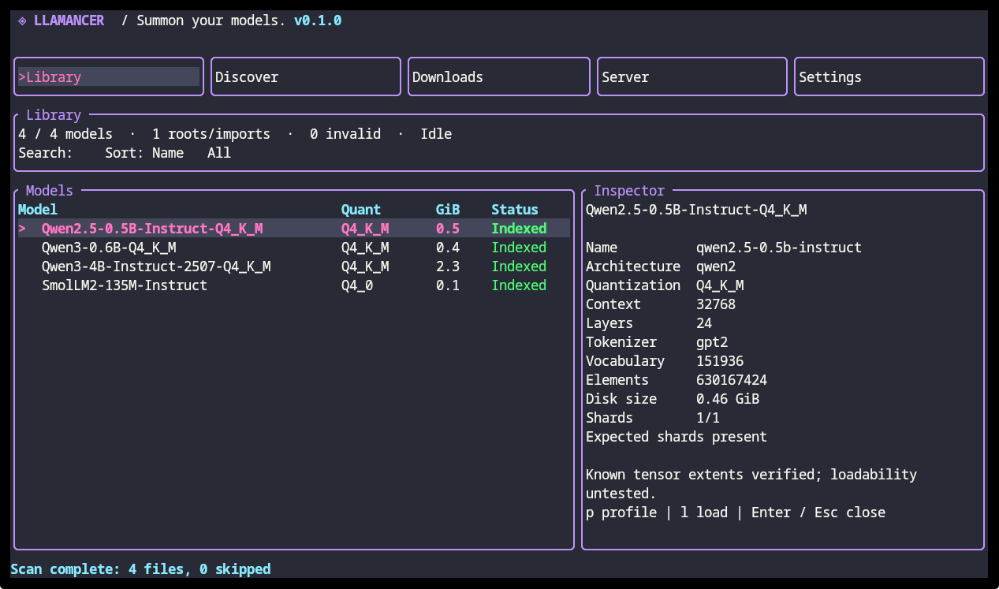

<div align="center">


# Llamancer

*Summon your models.*

[](https://github.com/0xlillith/llamancer/actions/workflows/ci.yml)
[](LICENSE)
[](docs/STATUS.md)

**A lightweight Rust TUI for llama.cpp model and inference management.**
**OMP-first. Not OMP-only.**

</div>

Llamancer brings local GGUF model discovery, inference preferences, server control, Hugging Face downloads and coding-agent launch into one terminal-native workspace. It does not bundle model weights, install GPU drivers, or rewrite your agent configuration.

## Status

Pre-release development, targeting the first Linux beta. Native Linux x86_64 and aarch64 CI, managed CPU text/vision inference, checksum-verified public and authorized gated Hub downloads, systemd lifecycle, Arch package installation, AMD Vulkan/ROCm text and vision inference, pinned CPU/Vulkan/ROCm source builds, real OMP/Pi tool use and graphical agent exit have passed their documented acceptance tests. Authenticated OMP uses an isolated temporary profile. No general model compatibility, comprehensive security audit or stable-release certification is implied. See [verified status](docs/STATUS.md), [desktop results](docs/DESKTOP-RESULTS.md) and [release review](docs/BETA-REVIEW.md).

| Workspace | Current functionality |
| --- | --- |
| Library | Read-only GGUF indexing (including Hugging Face cache snapshot links), shard grouping, search, favorites, inspector, inference profiles, import, hide/restore and recoverable managed-file quarantine |
| Discover | Paginated Hugging Face search, exact repository lookup, license/quantization filters, pinned revisions and shard selection |
| Downloads | Persistent queue, sequential resumable transfers, bounded retry, throughput and ETA, free-space checks, file locking and integrity validation |
| Server | External attach, managed session, headless router supervisor, router presets, load/unload, logs, Web UI and btop |
| Settings | XDG TOML preferences, Dracula/high-contrast/custom themes, model roots, agent, server executable, device selection, project directory |

## Screenshots



[More screenshots and terminal captures](docs/SCREENSHOTS.md): inference profiles, live Hugging Face discovery, download queue, Backend Manager and active inference router.

## Quick start

Requirements: Linux, a terminal, Rust 1.88 or newer to build from source, and a compatible llama-server for inference (installed through Backend Manager or separately). OMP or Pi is optional. Install external software from its official source; Llamancer does not install or upgrade it.

```sh
git clone https://github.com/0xlillith/llamancer.git
cd llamancer
cargo run --locked --release
```

1. Open Settings (5), add an existing absolute model directory, and optionally specify the llama-server executable and agent project directory.
2. Open Library (1), scan with r, inspect a model with Enter and edit its inference profile with p.
3. Press l to launch an owned single-model session, or open Server (4) and press s to start a router using indexed models and generated presets. Press r to attach to an existing server instead.
4. In the Server view, select a router model and press l to load it. Once ready, press a to launch the configured agent in the current terminal. Return to Llamancer by exiting the agent.
5. Press x in Server to stop an owned session. External servers are never stopped by Llamancer.

Keyless OMP launches use the documented LLAMA_CPP_BASE_URL runtime override; check for conflicting native provider settings before using it. Authenticated OMP launches use a temporary private agent profile and daemon directory, with an explicit selected provider. Personal OMP settings are not read into this profile or rewritten. The temporary profile and its daemon are cleaned up on exit; do not use this mode for persistent agent history or background jobs. Authenticated Pi launches require the scoped pi adapter rather than pi-native. Pi uses a Llamancer-owned session extension with the selected endpoint and model; choose pi-native for the upstream router provider (LLAMA_BASE_URL). Existing agent settings remain untouched. The compatibility extension supports text only and requires an advertised or configured context size. The configured custom agent receives LLAMANCER_ENDPOINT and LLAMANCER_MODEL.

For Arch-based systems, see the [experimental VCS package](packaging/arch/README.md). Binary tarballs and checksums are available as [workflow artifacts](https://github.com/0xlillith/llamancer/actions/workflows/release.yml) until a stable release is published.

## Model fit advisory
Press `m` in Library to see the selected model's disk size, conventional attention KV estimate, requested GPU offload and available system RAM. Probe the configured backend with `i` in Server first to include its last reported per-device memory. Full-offload/CPU comparisons flag likely capacity pressure; partial/automatic offload and unsupported hybrid architectures remain explicitly uncertain. This is not a guarantee and does not change settings automatically.

## Model storage
Add multiple model roots in Settings and optionally choose a Default download root. In Discover, `d` uses that default (or opens the picker when multiple roots exist without a default), and `D` always opens the destination picker. The picker shows total bundle size and free space per root. Queue entries retain their original destination across restart and default changes. New bundles require space for the full file(s); resume of already queued files still checks the actual remaining bytes.

## Project workspaces
Set **Workspace parent directory** in Settings to a directory containing your projects (for example `/home/user/src`). Press `P` in Server or Settings to select an immediate project folder. The selected project becomes the working directory for OMP, Pi or custom agents. Hidden folders and symlink entries are excluded; discovery is bounded. You can also set an explicit Active project directory independently. If a workspace is configured but no project is selected, agent launch asks you to select one. Existing agent settings are untouched.

## Troubleshooting

Run `llamancer doctor` for an offline local setup report. It checks configured executables, model paths, optional agent/terminal tools and managed backend receipts without starting processes, making network requests, or printing paths, endpoint addresses or tokens. Use Backend Manager or `llamancer backend probe KIND` to check actual runtime device compatibility.

## Managed inference backends

Llamancer can install official llama.cpp distributions itself. No Unsloth, package manager, sudo, shell configuration or service is required. In **Server** or **Settings**, press `B` to open Backend Manager:

| Action | Key |
|---|---|
| Select CPU, Vulkan or ROCm | Up / Down |
| Browse newer/older reviewed release (upgrade/rollback) | v / u |
| Check recent upstream releases (read-only) | c |
| Download and install the pinned official build | i, then y |
| Probe the backend and list real devices | p |
| Select the installed backend for inference | Enter |
| Benchmark a selected small local model | b, then y |
| Remove an unused managed backend | d, then y |
| Cancel a running operation / return | x / Esc |

The reviewed catalog pins llama.cpp **b12721 and b12726**, with SHA-256 and archive sizes obtained from official GitHub release metadata. CPU and Vulkan are available on x86_64 and aarch64; ROCm is available on x86_64. Installations live under `$XDG_DATA_HOME/llamancer/backends` (default `~/.local/share/llamancer/backends`). Downloads are verified before extraction and published as private versioned directories. GPU selection refuses backends that expose no compatible device. Vulkan and ROCm still require compatible system GPU runtimes; no drivers are installed automatically.

Select a complete single-file GGUF of at most 512 MiB in Library before benchmarking. The quick test uses 128 prompt tokens, 32 generation tokens, two threads, two repetitions and eight GPU layers (zero for CPU). Stop all inference first. Confirm the selected GPU device in Settings, particularly on multi-GPU systems. Do not start unmanaged programs from Llamancer-owned backend directories during removal. External executable paths remain supported. Versions install side-by-side; select an installed version explicitly to switch or roll back. The reviewed catalog is updated through Llamancer releases; The read-only upstream check reports compatible newer builds with published SHA-256 metadata; unreviewed builds are not installable. Source compilation is a separate workflow.

Headless installation and diagnostics:

```sh
llamancer backend list
llamancer backend check
llamancer backend install vulkan
llamancer backend probe vulkan
llamancer backend install vulkan b12726
llamancer backend probe vulkan b12726
```

See [Backend Manager](docs/BACKENDS.md) for verification, platform requirements and current limits. For optional host-native compilation, see [pinned source builds](docs/SOURCE-BUILDS.md).

## Controls

| View | Keys |
| --- | --- |
| Global | 1–5 or Tab / Shift+Tab, mouse tabs and rows, ? help, q / Ctrl+C quit |
| Library | r scan, x cancel, / search, s sort, f favorite, v favorites only, Enter details, p profile, l load, i invalid files, h hide, t quarantine |
| Discover | / search, Enter submit/open repo, Backspace back, n next page, d queue file or shard bundle |
| Downloads | r resume, R run queue, x pause, z remove queue entry (keeps files), t quarantine, T restore |
| Server | r refresh, D detach, i probe backend, s router, x stop owned, l/u load/unload, a agent, A current terminal, g logs, w Web UI, b btop |
| Profile | Up/Down, Enter edit, a advanced/basic, s save, Esc discard, Ctrl+U clear input |

## Themes
The default Dracula theme is joined by **Andromeda** (pastel violet, pink and cyan on a deep navy background), Catppuccin Mocha, Tokyo Night, Nord, Rosé Pine, Gruvbox Dark and High Contrast. Press uppercase `T` in Settings to cycle built-ins instantly, or edit the Theme field by name. Custom TOML themes remain supported. The header shows the active agent/project and theme; selected rows retain a textual marker and colored emphasis. No Nerd Font is required.

## Terminal accessibility

Click a tab or a visible list row to select it; use the mouse wheel or Up/Down to move the selection. Actions retain their contextual keyboard shortcuts. Selected entries have a textual marker as well as a color highlight. Choose the built-in `high-contrast` theme in Settings for increased contrast.

## Local-first by design

- No telemetry or mandatory accounts. Network access is user-triggered discovery, transfers, or explicitly configured inference endpoints.
- Models remain in place; indexing never reads tensor weights or deletes files.
- Configuration and downloads use versioned or typed TOML beneath the XDG config directory. Custom themes live in its themes subdirectory.
- Managed servers bind to loopback and are session-scoped. They stop when Llamancer exits. External servers remain independent.
- Downloaded files are stored under the first model root, by repository and pinned revision. Partial files use a .part suffix and are not indexed. Set HF_TOKEN in the environment if a repository requires authentication. Llamancer never sends that token to redirect hosts outside huggingface.co.
- Profiles separate engine options from generation defaults. Auto inherits backend defaults; unsupported CLI flags are rejected during launch. Advanced profiles accept an explicit multimodal projector path; Settings accepts a supported device identifier or automatic selection.

## Hub discovery and private repositories

In Discover, use a query such as `qwen license:apache-2.0 quant:Q4_K_M`, or `@owner/repository quant:Q4_K_M` to open an exact repository (including a private one). Quantization filtering is filename-based; projector candidates remain visible. For gated repositories, accept the license/access conditions on Hugging Face first. Llamancer reads HF_TOKEN or the standard local Hub token file (HF_TOKEN_PATH, HF_HOME, XDG_CACHE_HOME, or the default cache). Credentials are sent only to the exact HTTPS Hub origin, never to CDN redirects. If no authoritative SHA-256 is provided, a partial download restarts instead of trusting a previous prefix; a complete file can be checked only by its declared size. No credentials are stored in the download queue.

Cached Hugging Face credentials must be a regular, owner-only file (mode 0600), not a symlink or hard link. If needed, use `chmod 600 ~/.cache/huggingface/token`. Explicit `HF_TOKEN` is supported; `HF_HUB_DISABLE_IMPLICIT_TOKEN=1` disables automatic cached-token discovery. Credentials are never added to the download queue or sent outside the Hub origin.

## Library and endpoint safety

- Import a single GGUF by absolute path in Settings without copying weights; matching multipart siblings are indexed automatically. The Library inspector estimates weight and KV-cache sizes for conventional supported attention architectures. This is not a VRAM fit guarantee.
- Press i to inspect invalid GGUF paths, or h to hide a selected model after confirmation. Hidden models are excluded from future indexing and managed router presets. Restore by exact identity path in Settings. Files are never deleted by this operation.
- For authenticated inference, create a private file (mode 0600) containing one API token and set its absolute path in Settings. The token is not written to TOML or command-line arguments. Remote authenticated endpoints require HTTPS; managed servers bind to loopback. Use A for authenticated agent launches in the current terminal; Kitty remote launch is deliberately unavailable for these credentials.
- One TUI at a time may write a configuration directory. Local bounded diagnostics.jsonl records event codes and counters, not prompts, paths or credentials.

### Recoverable model quarantine

Press `t` in Library or Downloads to quarantine a complete managed model bundle, and `T` in Downloads to restore it. Confirm explicitly after stopping all inference servers. Only files newly published by Llamancer with an authoritative SHA-256 and persisted inode receipt are eligible; imported files, legacy queue entries, changed files and files without a checksum are refused. Linux write leases and readable same-user procfs mapping checks reject in-use files; local mapping inspection and a write lease are mandatory. Managed files must remain owner-only. Other processes may be hidden by OS access controls, and this is not protection from privileged processes, hidden PID namespaces or hostile same-user mutation. Stop all inference before confirming. The configured local endpoint must be idle. Llamancer cannot detect unloaded paths registered in arbitrary external servers, so stop them before confirming.

Quarantine renames the files in place with a `.llamancer-quarantine` suffix; no bytes are deleted and no disk space is reclaimed. Restoring never overwrites an existing path. If interrupted during a multipart move, queue state is reconciled on restart and the same operation or restore can resume. Ownership records are retained. Do not manually rename or replace quarantined files unless recovering outside Llamancer.

## Persistent router (optional)

Run `llamancer serve` to supervise a router using your saved model roots and profiles without a terminal UI. Stop it with Ctrl+C when running interactively. A sample systemd user unit is included in [packaging/systemd](packaging/systemd/README.md); installation and enablement are explicit user actions. The TUI can attach to that endpoint with r. Restart the supervisor when changing model roots, profiles or device settings.

## Agent terminal modes

Select current, kitty-tab or kitty-window in Settings. The a shortcut uses the configured mode, while A always launches in the current terminal. Kitty modes require its existing, authorized remote-control configuration and the kitten executable. Llamancer never enables remote control automatically. If launching fails, use A instead.

## Development

The [desktop acceptance runbook](docs/DESKTOP-ACCEPTANCE.md) describes the remaining GPU, agent, terminal, authorized Hub and release checks, with isolated test commands and evidence requirements.

```sh
cargo fmt --all -- --check
cargo test --locked --all-targets
cargo clippy --locked --all-targets -- -D warnings
cargo build --locked --release
python3 tests/terminal_smoke.py target/release/llamancer
```

CI runs on native Linux x86_64 and aarch64. The optional Live CPU smoke tests workflow checks a pinned upstream llama-server and a tiny checksum-verified GGUF fixture, plus live Hub download/resume and managed quarantine/restore. Its optional multimodal input runs real single-model and router image inference with a checksum-pinned SmolVLM model and projector. The Arch package workflow builds and installs the VCS package in an isolated Arch x86_64 container. Release builds produce tarballs, third-party notice inventories and SHA-256 files as workflow artifacts; no registry publication or stable release is automatic.

Read [Architecture](docs/ARCHITECTURE.md), [Implementation specification](docs/IMPLEMENTATION.md), [GGUF indexing](docs/GGUF.md), [Integrations](docs/INTEGRATIONS.md), [Roadmap](docs/ROADMAP.md), [Status](docs/STATUS.md), [Release validation](docs/RELEASE-VALIDATION.md) and [Contributing](CONTRIBUTING.md).

Meet [Hex](assets/hex-mascot.webp), our llama sorcerer and project mascot. The default palette is Dracula-inspired.

## License

MIT. Llamancer is an independent project and is not affiliated with llama.cpp, Oh My Pi, Pi or Hugging Face.

Local TOML settings and download queues are bounded to 16 MiB; custom themes to 64 KiB. Use regular user-owned state files that are not writable by other users. Final-component symlinks and special files are rejected to prevent startup hangs or unintended reads.
