# Screenshots and terminal captures

## Polished Nerd Font interface

These captures show the running application with the optional JetBrainsMono Nerd Font Mono glyphs on CachyOS. The first is a real KDE active-window screenshot; the four remaining images are rasterizations of actual Kitty terminal buffers. All paths in the storage demo are temporary; no private repositories, credentials or model files are included. The portable icon mode also works without Nerd Fonts.

### Andromeda Library

### Catppuccin Mocha

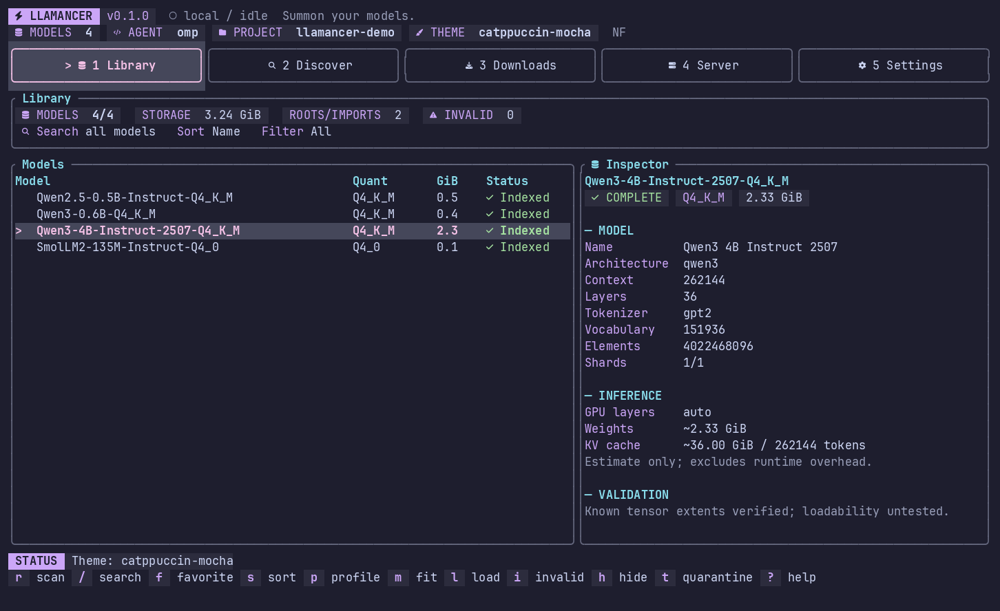

### Backend management

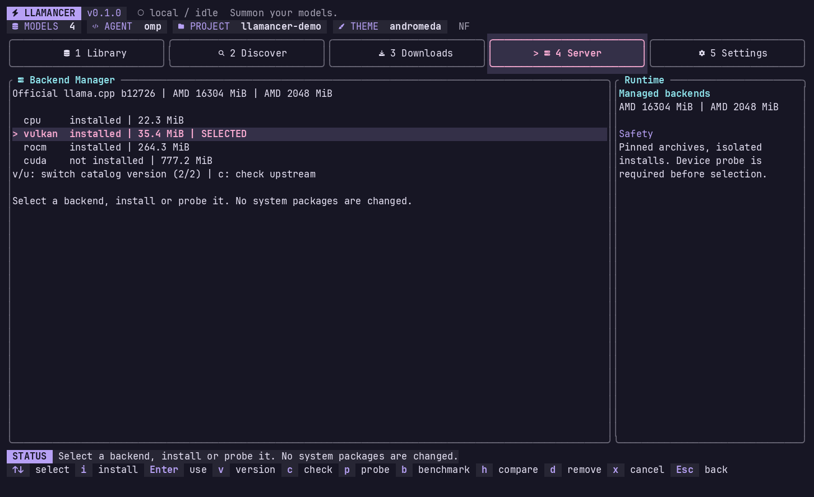

### Public Hub discovery

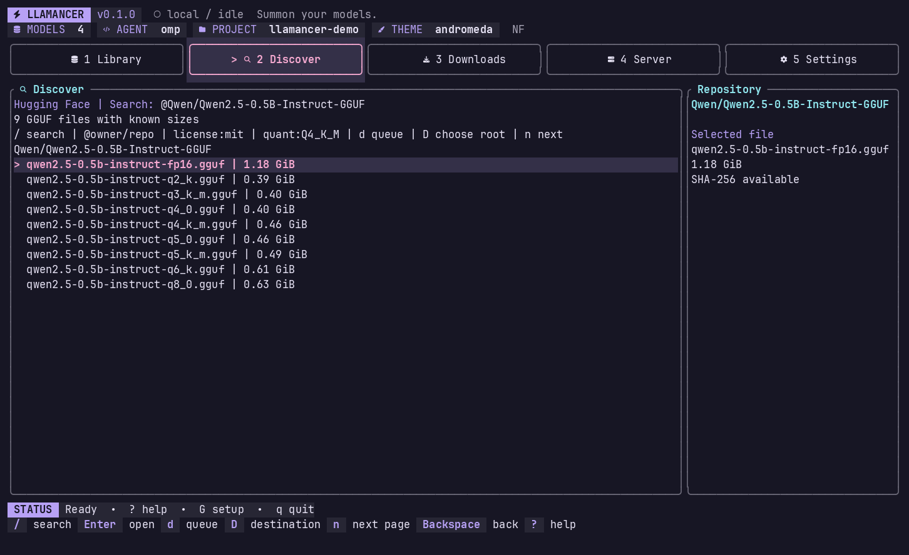

### Storage planning

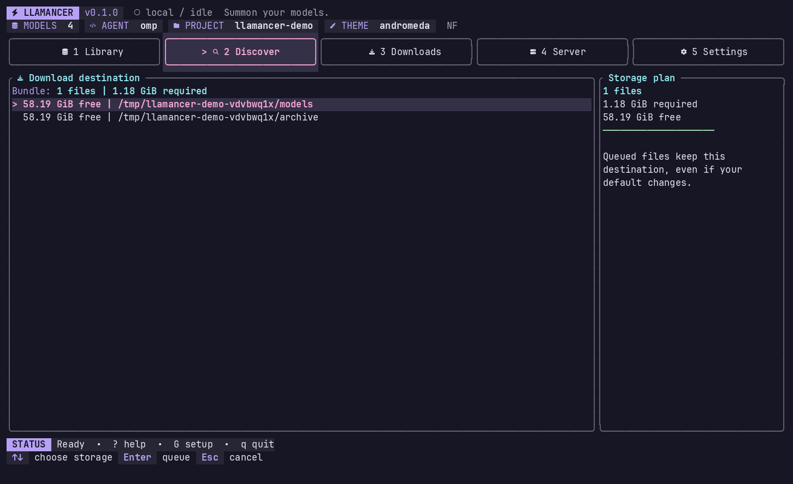

## Earlier captures

The original captures below show the running Llamancer v0.1.0 on CachyOS with Kitty and the default Dracula theme. An isolated temporary configuration used public GGUF fixtures and a public Hub repository; no personal configuration or credentials are shown. The Library is a KDE active-window screenshot. The other images are rasterizations of the actual ANSI terminal buffer exported from Kitty, not mockups or independent desktop screenshots.

## Library

Four indexed public GGUF models and the metadata inspector.

## Inference profile

Basic per-model engine and generation options. Advanced mode exposes additional parameters.

## Hugging Face discovery

Live public repository lookup, with nine quantization files and their sizes.

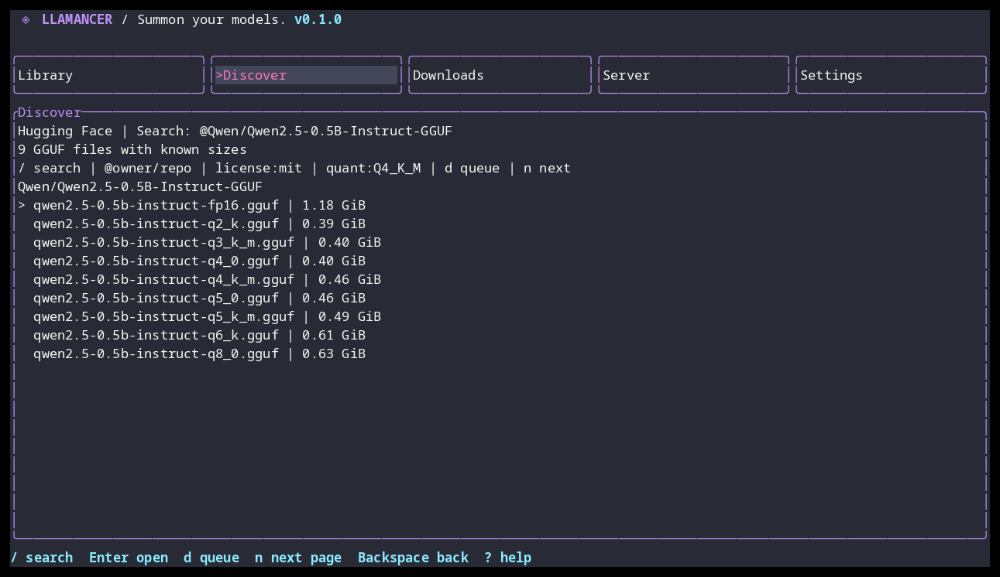

## Download queue

A real file entry queued for download in the isolated demo; no download was started.

## Backend Manager

Real installed CPU, Vulkan and ROCm receipts; Vulkan selected on the test host.

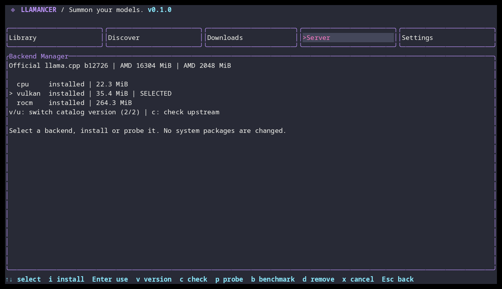

## Active inference router

A real managed Vulkan router, with Qwen2.5 loaded and three other indexed models available. The isolated loopback server was shut down after capture.

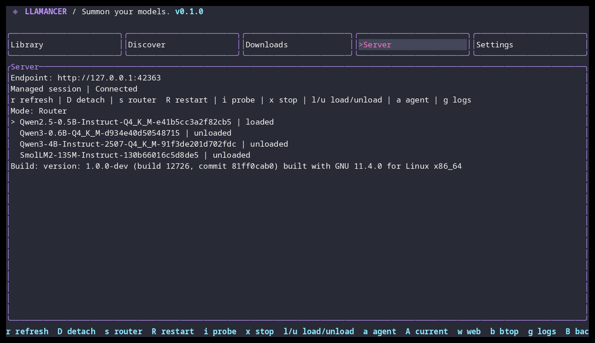

## Refreshed terminal interface

These six images are rasterizations of actual Kitty ANSI buffers from the updated application on Andromeda. The demo used temporary public model copies and synthetic workspace directories. Benchmark results are actual measurements; CUDA was not measured.

### Andromeda

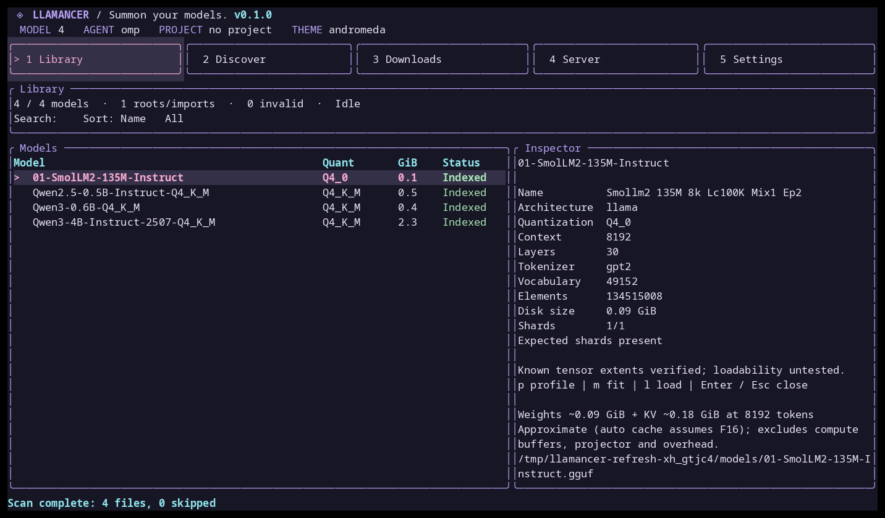

### Catppuccin Mocha

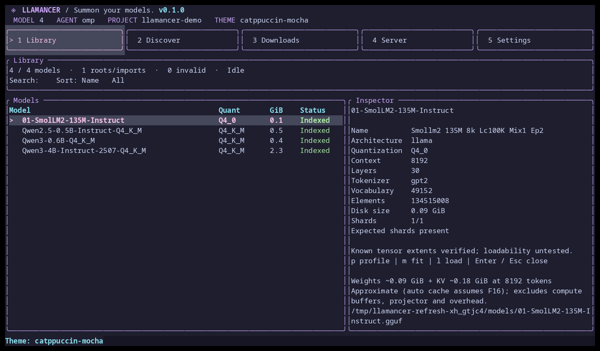

### Project workspace

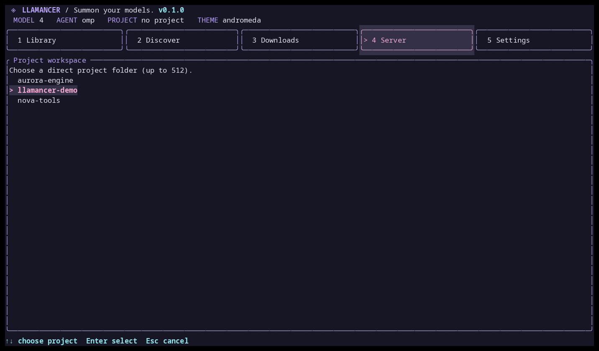

### Guided setup

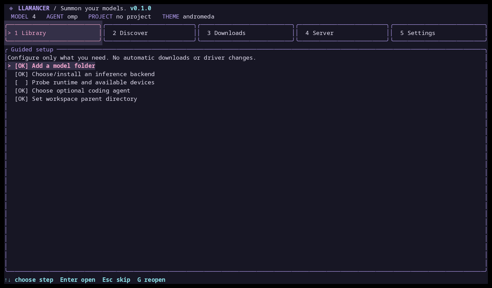

### Memory advisory

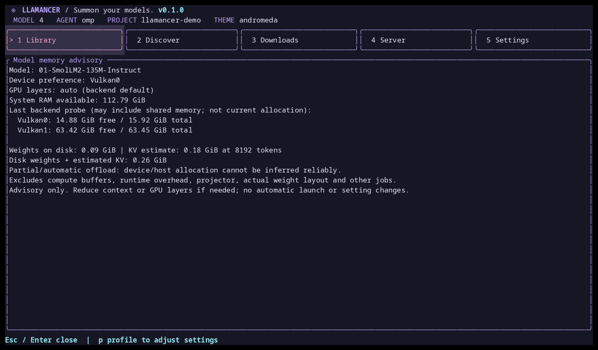

### Benchmark comparison

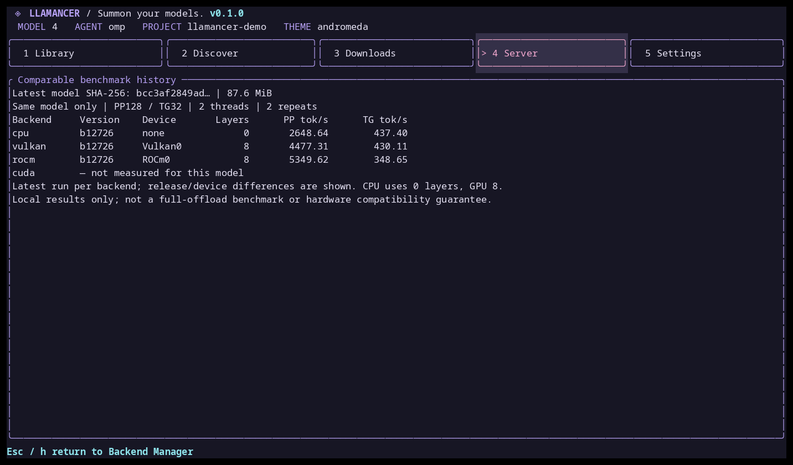
