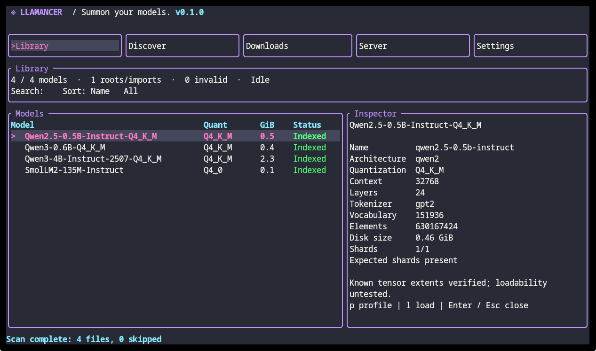
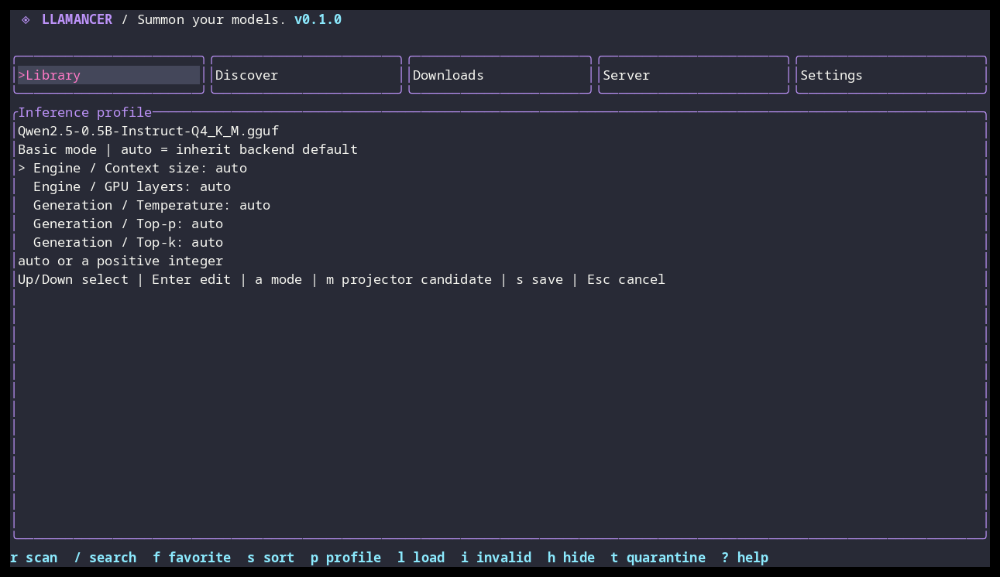
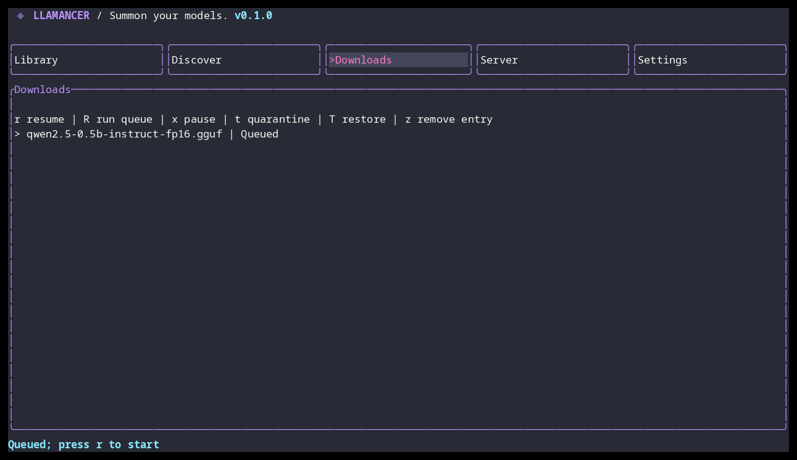

# Screenshots and terminal captures

Captured from the running Llamancer v0.1.0 on CachyOS with Kitty and the default Dracula theme. An isolated temporary configuration used public GGUF fixtures and a public Hub repository; no personal configuration or credentials are shown. The Library is a KDE active-window screenshot. The other images are rasterizations of the actual ANSI terminal buffer exported from Kitty, not mockups or independent desktop screenshots.

## Library

Four indexed public GGUF models and the metadata inspector.

## Inference profile

Basic per-model engine and generation options. Advanced mode exposes additional parameters.

## Hugging Face discovery

Live public repository lookup, with nine quantization files and their sizes.

## Download queue

A real file entry queued for download in the isolated demo; no download was started.

