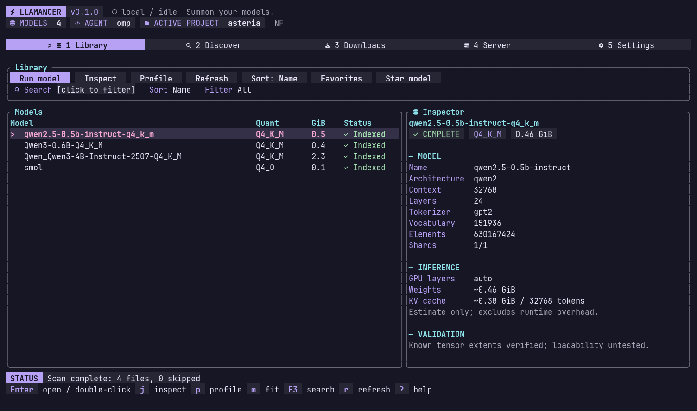
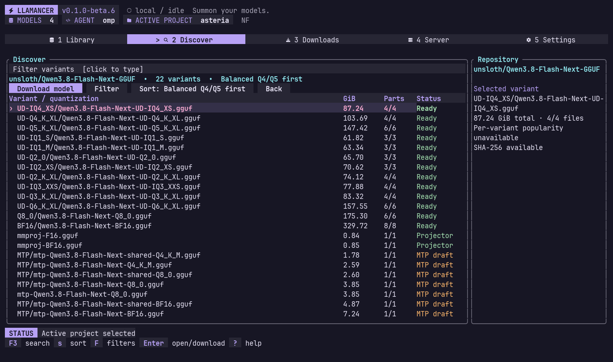
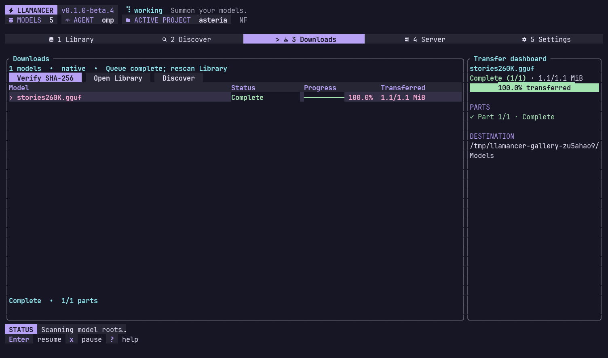
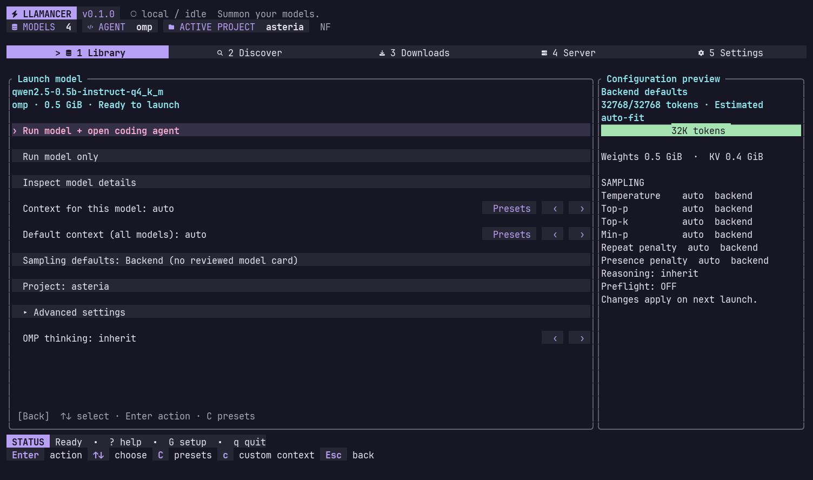
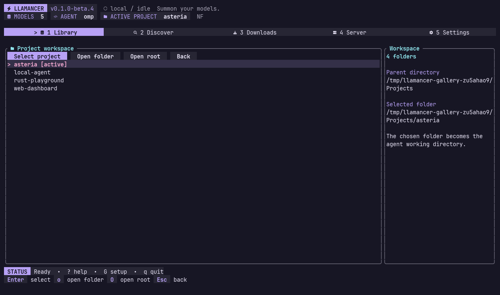
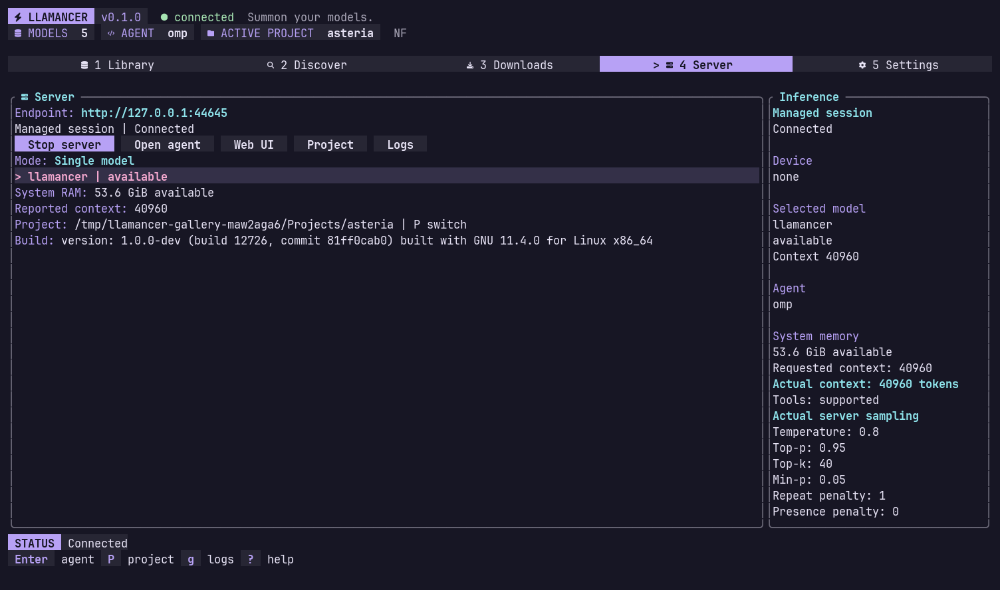
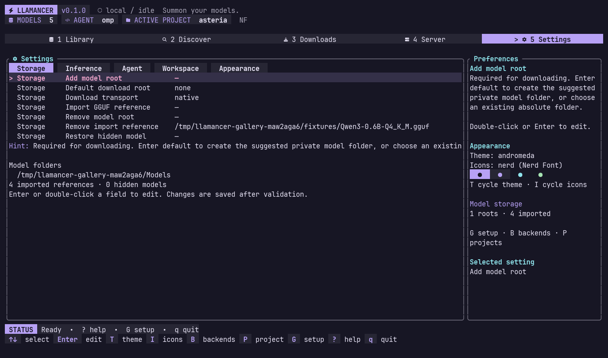

# Llamancer user guide

This guide describes the development branch following beta.4. Build the current
source to use these features; released beta.4 does not contain all of them.
Llamancer runs on Linux and manages local GGUF inference through llama.cpp.
It is not a model trainer or a GPU driver installer.

## 1. First launch

Run `llamancer` (or `cargo run --locked --release` from the source tree).
Click tabs or use 1–5; press G for guided setup. Confirm a model directory.
In Server or Settings, press B for Backend Manager. Select CPU, Vulkan or
ROCm, install a reviewed backend if necessary, probe devices, then select it.
CUDA is experimental and has not been verified on NVIDIA hardware.

## 2. Find and download a model

Open Discover and type immediately. Search by name, or enter an exact
repository such as `@unsloth/Qwen3.8-Flash-Next-GGUF`. Enter submits the search.
Use Sort and Filter for repository rankings, author, license or quantization.
Click a repository to select it, then double-click or Enter to open it.
Within a repository, filter variants and compare their aggregate sizes.

A variant groups all its GGUF shards, not all the repository's files.
Balanced ordering prefers conventional Q4/Q5 names; it is a heuristic,
not a quality score or an actual per-variant popularity ranking.
Known separate MTP draft weights are labelled and excluded from standalone
downloads/launches; speculative attachment is not yet implemented.
Vision projectors are optional separate files. Select a complete main variant,
confirm the destination, and the queue starts automatically.

## 3. Transfer, resume and verify

Downloads shows model-level progress, completed parts, byte totals, recent
speed and per-part errors. Pause with x and resume with Enter or r.
The chosen destination remains pinned across restarts. Library refreshes
automatically on successful completion.

Settings → Storage → Download transport selects Native (the built-in
downloader, default) or Hub (the official `hf` CLI, installed separately
with its optional Xet support). Hub downloads into its cache and Llamancer
independently verifies a staged local copy. Allow enough space for the cache
and model destination. When resuming, the existing staged prefix must match
the verified cache blob; a mismatch is retained for inspection. Hub resume
never silently switches to the native HTTP downloader. Network-cache progress
is indeterminate; byte counts and rates describe the local staging copy, not
Hub network throughput. Same-hash local fragments can be reused without
trusting unverified bytes.

On checksum failure, do not bypass verification. Inspect the expected and
actual digest, then use Retry fresh (F) if you want a fresh transfer while
preserving the failed partial. Verify SHA-256 (V) in Library or Downloads audits a completed managed
model against its pinned digests. Failed audits persist and prevent managed
launch until revalidation succeeds. Independent direct-read checks are
attempted on mismatch when the filesystem supports them; a matching direct
read alone does not override a failed buffered hash. Missing checksums
cannot establish cryptographic integrity. The audit dashboard shows the part and byte progress of each read pass. Cancel with x. From a terminal, after closing the TUI or headless supervisor, run `llamancer verify` to check all completed managed parts with pinned hashes.

## 4. Configure and launch inference

Select a complete model in Library and open its launch panel. Review the
configuration preview. Context for this model overrides the global
preference; Auto inherits a fixed global value or aims at 128K where model
metadata and memory permit. The planner uses conservative conventional
attention estimates and a bounded native helper for supported hybrid models.
If no reliable estimate is possible, the backend decides. A large requested
context is not a guarantee of fit or useful context quality.

Reviewed mode-specific recommendations are applied only for known model
families/repositories. Explicit custom sampling settings take precedence;
unknown models inherit GGUF/backend defaults. The preview distinguishes
recommended settings from explicit overrides. Advanced settings expose
thinking effort and other optional parameters. Select the thinking mode
appropriate to the model and task; a successful synthetic tool-call probe
does not establish reliable tool use for every prompt.

Choose **Run model + open coding agent** (or Enter on that action) to start
inference and wait for readiness before opening a separate Kitty window.
Choose **Run model only** to start inference without an agent.
Preferences are saved; changing a running single-model profile requires
relaunch. Router profiles require a router restart.

## 5. Projects and agents

Set the workspace parent directory to the folder containing your projects.
Select an actual project subfolder as Active project, which becomes the
agent's working directory. Choose Project in the launch panel or P in
Server/Settings. Click Browse folder when KDialog or Zenity is available;
otherwise enter the path in the terminal. The desktop dialog runs asynchronously; press Esc in Llamancer to cancel it without saving, or close the dialog normally. An explicit active project can
also be configured independently.

OMP is the default optional coding agent. Pi and custom commands are supported.
Install your chosen agent and Kitty separately. Llamancer does not rewrite
personal agent configuration. For authenticated launches, see the README's
authentication notes. Closing the final agent window releases inference
started for that agent, while a separately started server remains running.

## 6. Observe and stop inference

The Server panel reports the actual context and sampler settings returned by
the active endpoint when available. It can open the agent or Web UI, display
logs, stop an owned session, unload a router model or disconnect an external
session. External servers are never stopped by Llamancer.
Use the explicit Stop server button (x) when finished.

## 7. Personalize and troubleshoot

Settings groups Storage, Inference, Agent, Workspace and Appearance.
Preferences persist in the XDG configuration directory. Choose from built-in
themes, or use custom theme TOML. Optional Nerd Font icons fall back to plain
Unicode; the terminal font must support the selected glyphs.

Run `llamancer doctor` to inspect local setup without starting inference or
sending a network request. Use backend probing and the Server logs to
diagnose a launch. Report the model repository/revision, quantization,
backend/version, effective context/sampler settings and a minimal reproducible
example in GitHub issues; omit tokens, private paths and proprietary prompts.

See the [README](../README.md), [backend guide](BACKENDS.md), and
[model workflow design](MODEL-WORKFLOW.md) for implementation details.
